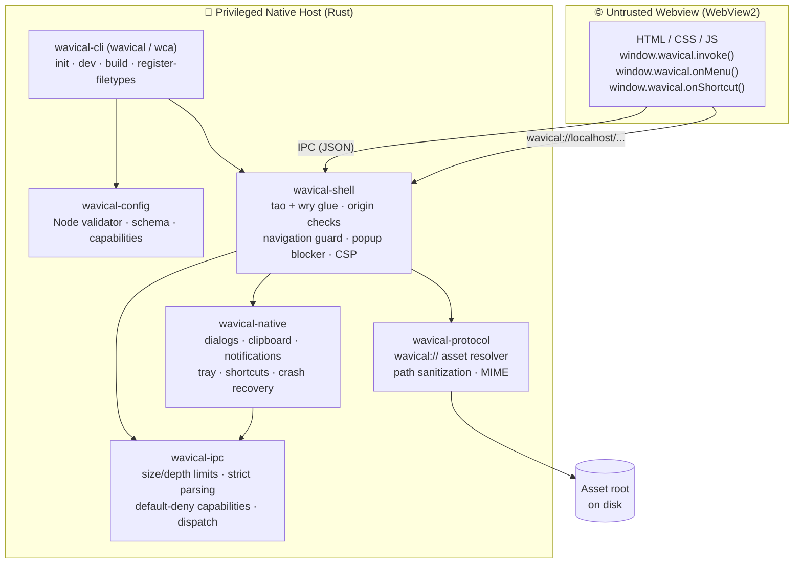

<div align="center">

# 🌊 Wavical

**A lightweight, security-first desktop app framework built in Rust.**

*Build native desktop apps with HTML, CSS, and JavaScript, without shipping a whole browser and without trusting the webview.*

[](https://github.com/dhananjay-ryu-jin-sama/Wavical/actions/workflows/ci.yml)


-blue)

[Why Wavical](#-why-wavical) •
[Quick Start](#-quick-start) •
[Architecture](#-architecture) •
[Security Model](#-security-model) •
[JavaScript API](#-javascript-api) •
[Testing](#-testing) •
[Roadmap](#-roadmap)

</div>

---

> [!NOTE]
> **Wavical is in active pre-release development (Phase 2: Native Tier 1 APIs complete).** The foundational shell, developer CLI (`wavical` / `wca`), hot-reload dev server, build pipeline, and native APIs (scoped file dialogs & grant tables, clipboard, desktop notifications, system tray, native context menus, global shortcuts, single-instance lock, crash recovery, and Windows file associations) are operational. Windows is currently the primary supported desktop runtime. ⭐ Star or watch the repo to follow along.

---

## ✨ Why Wavical?

Electron bundles a full Chromium and Node.js runtime with every app. Tauri improved on that a lot. Wavical goes further in one direction: **assume the page is hostile, and enforce everything in compiled Rust.**

| | Principle | What it means in practice |
|:-:|---|---|
| 🪶 | **Lightweight** | Uses the OS-provided **WebView2** runtime through [`tao`](https://github.com/tauri-apps/tao) and [`wry`](https://github.com/tauri-apps/wry). No bundled browser engine. |
| 🛡️ | **Default-deny** | Every window starts with **zero** capabilities. IPC methods, origins, navigations, popups, and native APIs are blocked unless explicitly allowed. |
| 🔑 | **Scoped file access** | The webview **never** touches a raw file path. Files chosen via native dialogs yield opaque, unguessable grant tokens verified in Rust at time-of-use. |
| 🦀 | **Memory-safe** | `#![forbid(unsafe_code)]` in pure crates. No `unwrap()`/`expect()` on untrusted input. |
| 🔬 | **Verified** | 230+ unit, property, and black-box security audit tests (`proptest`), `cargo-fuzz` harnesses, and a live **adversarial attack page** run in CI. |
| 🤐 | **No leaks** | Errors returned to the page are generic. Internal paths, rejection reasons, and file layouts stay out of the webview. |
| 🤖 | **AI-native (planned)** | Local LLM runtimes, embedded RAG, and model management are first-class roadmap goals. |

---

## 🚀 Quick Start

### Prerequisites (Windows 10/11)

```powershell
winget install --id Git.Git -e
winget install --id Rustlang.Rustup -e
winget install --id Microsoft.VisualStudio.2022.BuildTools -e --override "--wait --passive --add Microsoft.VisualStudio.Workload.VCTools --includeRecommended"
winget install --id Microsoft.EdgeWebView2Runtime -e   # usually preinstalled on Windows 11

rustup default stable
rustup component add rustfmt clippy
```

> [!TIP]
> Restart your terminal after installing so `PATH` updates. If you see `link.exe not found`, the **Desktop development with C++** workload is missing. See [`docs/WAVICAL_SETUP.md`](docs/WAVICAL_SETUP.md) for the full setup guide.

### 1. Using the Developer CLI (`wavical` / `wca`)

Clone and build or install the CLI locally:

```powershell
git clone https://github.com/dhananjay-ryu-jin-sama/Wavical.git
cd Wavical

# Option A: Install CLI tools into your Cargo bin directory
cargo install --path crates/wavical-cli

# Scaffold a new app (both `wavical` and shorthand `wca` work identically)
wavical init my-app
cd my-app

# Start the interactive dev server (watches assets & config with hot-reload)
wavical dev

# Build production-ready assets with SHA-256 manifest
wavical build

# Register or unregister Windows file associations declared in config (HKCU only)
wavical register-filetypes
wavical unregister-filetypes
```

```powershell
# Option B: Run commands directly via Cargo without installing
cargo run -p wavical-cli -- init my-app
cd my-app
cargo run -p wavical-cli -- dev
cargo run -p wavical-cli -- build
```

### 2. Run the Interactive Security & Native Demo App

```powershell
# From the repository root:
cargo run -p wavical-shell
```

A window opens and loads [`examples/hello`](examples/hello) over the secure `wavical://` protocol. The demo lets you test the security boundary and Native Tier 1 APIs interactively:

| Feature / Action | Expected Result | Enforced By |
|---|---|---|
| **Ping** → `core.ping` | ✅ Returns `{ "message": "pong", "version": "0.1.0" }` | Granted capability |
| **Echo** → `core.echo` | 🛡️ Rejected with `Method not allowed or not found` | Default-deny capability check |
| **Clipboard** → `clipboard.write` / `read` | ✅ Copies/pastes text (max 1 MB payload) | `wavical-native` + capability check |
| **Desktop Notifications** → `notify.send` | ✅ Emits native OS notification banner | `wavical-native` (`notify-rust`) |
| **File Dialog** → `dialog.openFile` | 🔑 Returns opaque `grantId`, **never raw path** | Opaque `GrantTable` token |
| **Scoped Read** → `fs.readGranted` | ✅ Reads file by `grantId` (re-validated, max 10 MB) | Rust path re-validation guard |
| **Raw Path Injection Attack** | 🛡️ Rejected: raw paths rejected by strict schema | `deny_unknown_fields` on IPC |
| **System Tray & Menus** → `tray.set` | ✅ Native tray icon with tooltip and menu items | `muda` + `tray-icon` on UI thread |
| **Global Shortcuts** → `shortcut.register` | ✅ Registers global key accelerator (e.g. `Ctrl+Shift+H`) | `global-hotkey` + event bridge |
| **Navigate** → `https://example.com` | 🛡️ Blocked, stays on app origin | Navigation guard |
| **Popup** → `window.open()` | 🛡️ Blocked (`NewWindowResponse::Deny`) | New-window handler |
| **Remote script** from a CDN | 🛡️ Blocked | Content-Security-Policy |

> [!NOTE]
> Run `cargo run -p wavical-shell` from the repository root. The shell loads `examples/hello` relative to the current directory. Set `RUST_LOG=debug` to see structured security events in the console.

---

## 🏗️ Architecture

Wavical is organized as a modular Cargo workspace. **Security-critical logic lives in pure crates** that don't depend on any windowing library, so it can be tested, property-tested, and fuzzed on any platform, including Linux.



### Repository layout

```text
Wavical/
├── crates/
│   ├── wavical-cli/        # Developer CLI (wavical, wca) with init, dev, build, and file associations
│   ├── wavical-config/     # Node-evaluated config loader, Zod-style validator, capabilities
│   ├── wavical-ipc/        # Pure: JSON-RPC parsing, limits, capabilities, grant table, registry
│   ├── wavical-native/     # Native Tier 1: dialogs (rfd), clipboard (arboard), notify, tray, shortcuts
│   ├── wavical-protocol/   # Pure: wavical:// path sanitization, canonical root checks, MIME
│   └── wavical-shell/      # Window + webview host (tao/wry), dynamic reloader & IPC bridge
├── examples/hello/         # Interactive demo app with Phase 0 & Phase 2 capability tests
├── tests/
│   ├── attack-page/        # Adversarial HTML/JS that tries to break the sandbox
│   └── integration/        # Headless-style runner that drives the attack page and reports
├── fuzz/                   # cargo-fuzz targets (parse_message, capability_dispatch, resolve_path)
├── docs/                   # Security model, setup guide, phase build plans, feature checklist
├── .github/workflows/      # CI: Windows full workspace, Linux pure + CLI crates, supply-chain audit
├── deny.toml               # cargo-deny license / advisory / ban policy
├── ROADMAP.md
└── SECURITY.md
```

| Crate | Depends on tao/wry? | Responsibility |
|---|:-:|---|
| [`wavical-cli`](crates/wavical-cli) | ❌ | CLI interface (`wavical` & `wca`), project scaffolding (`init`), dev watcher (`dev`), asset packaging (`build`), filetype registration (`register-filetypes`) |
| [`wavical-config`](crates/wavical-config) | ❌ | Evaluates `wavical.config.js` via Node subprocess, enforces schema, typo suggestions |
| [`wavical-ipc`](crates/wavical-ipc) | ❌ | Message validation, `Capabilities`, `GrantTable`, `HandlerRegistry`, `NativeHandler` trait, dispatch |
| [`wavical-native`](crates/wavical-native) | ✅ (Windows) | Dialogs (`rfd`), clipboard (`arboard`), notifications (`notify-rust`), tray (`tray-icon`), menus (`muda`), shortcuts (`global-hotkey`), single-instance (`interprocess`), crash recovery |
| [`wavical-protocol`](crates/wavical-protocol) | ❌ | `sanitize_path_segments`, `resolve_asset_path`, `get_mime_type` |
| [`wavical-shell`](crates/wavical-shell) | ✅ | `WindowConfig`, origin/navigation/popup policy, CSP headers, event loop, native delegate glue, dynamic IPC reload |

---

## 🛡️ Security Model

**Golden rule: the webview is untrusted.** The JavaScript bridge is a convenience. Every check that matters happens in Rust.

<details open>
<summary><b>🔑 Scoped file access & grant tables (<code>wavical-ipc</code> & <code>wavical-native</code>)</b></summary>

The webview **never** passes a file path to `fs.*`. File paths are never accepted from JavaScript.

- **Explicit User Action**: File paths enter the host *only* when the user picks a file through an OS-native dialog (`dialog.openFile` or `dialog.saveFile`).
- **Opaque Grant IDs**: Rust stores chosen paths inside a per-window `GrantTable` and returns an unguessable 128-bit random grant ID to JavaScript.
- **Time-of-Use Verification**: When `fs.readGranted` or `fs.writeGranted` is called:
  - Re-checks that target path exists and is a regular file.
  - Re-checks that target is **not** a symlink or junction.
  - Re-checks that target path contains no null bytes or NTFS Alternate Data Streams (`::$DATA`).
  - Re-checks that target path contains no Windows reserved device names (`CON`, `PRN`, `NUL`, etc.).
  - Verifies that the current canonical path still matches the canonical path recorded at grant time.
  - Enforces a hard **10 MB payload limit** on reads and writes.
- **Per-Window Isolation**: Grants are scoped to their window ID, cleared on window close, and can never cross windows.

</details>

<details>
<summary><b>🔌 IPC hardening (<code>wavical-ipc</code>)</b></summary>

- **1 MB raw size limit** checked *before* any JSON parsing
- **Max nesting depth of 32**, checked on raw text and on parsed values, to stop stack-exhaustion DoS
- **Strict schema**: `{ id, method, params }` with `deny_unknown_fields`. Rejects duplicate keys, extra fields, and wrong types
- **Request IDs** must be integers in `0 ..= 2^53 − 1` (`Number.MAX_SAFE_INTEGER`)
- **Method names**: `[a-zA-Z0-9_.-]`, 1–64 bytes, no `..`, no leading or trailing separators
- **Capability check before routing.** Ungranted and non-existent methods return the *same* generic error (`Method not allowed or not found`), preventing method probing
- **Strict parameter validation limits**:
  - Clipboard text: max 1 MB
  - Notification title: max 128 chars; body: max 1024 chars; no action URLs or buttons
  - Context menu items: max 200 items; shortcuts: max 32 registered per app

</details>

<details>
<summary><b>📁 Asset protocol hardening (<code>wavical-protocol</code>)</b></summary>

Requests to `wavical://` are rejected when they contain:

- Path traversal (`..`), including single or nested percent-encoding (`%2e%2e`)
- Mixed or back slashes, drive letters (`C:`), absolute roots, UNC shares (`\\server\share`)
- NTFS Alternate Data Streams (`file:stream`, `::$DATA`)
- Windows reserved device names (`CON`, `PRN`, `AUX`, `NUL`, `COM1–9`, `LPT1–9`)
- Trailing dots or spaces, null bytes, or paths longer than 2048 bytes
- Symlink or junction escapes. The canonical path must stay inside the canonical asset root

Every rejection returns the same plain `404 Not Found` with no path details.

</details>

<details>
<summary><b>🪟 Shell-level controls (<code>wavical-shell</code>)</b></summary>

- **Origin verification** on every IPC message. Iframes and foreign origins are dropped
- **Navigation guard**: only allowlisted app origins can load top-level
- **Popup blocking**: `window.open()` gets `NewWindowResponse::Deny`
- **Strict CSP** on every response, with no `'unsafe-inline'`:
  ```text
  default-src 'self'; script-src 'self'; style-src 'self'; img-src 'self' data:;
  font-src 'self'; object-src 'none'; base-uri 'none'; frame-ancestors 'none'; form-action 'self';
  ```
- **`X-Content-Type-Options: nosniff`** on all responses
- **Frozen bridge**: `window.wavical` is defined non-writable, non-configurable, and `Object.freeze`d
- **Single-instance locking**: prevents multiple conflicting processes via named local IPC
- **Webview crash recovery**: listens for WebView2 renderer process failure and prompts/auto-reloads
- **DevTools only in debug builds** (`cfg!(debug_assertions)`)

</details>

<details>
<summary><b>📊 Structured security logging</b></summary>

Every rejected action emits a `tracing` event with a consistent `security_event` field:

| Event | Fired when |
|---|---|
| `capability_denied` | Page calls a method it wasn't granted |
| `malformed_message` | Payload fails syntax, schema, depth, or type checks |
| `oversize_message` | Raw message exceeds 1 MB |
| `origin_rejected` | IPC arrives from an unauthorized origin |
| `path_rejected` | `wavical://` path fails sanitization |
| `navigation_blocked` | Top-level navigation to an external origin |
| `popup_blocked` | Page tries to open a new window |

Logged payloads are truncated to 64 bytes on UTF-8 boundaries. Secrets are never logged.

</details>

📖 Full details: [`docs/SECURITY_MODEL.md`](docs/SECURITY_MODEL.md)

---

## 🧩 JavaScript API

Wavical injects one frozen global object into every loaded page:

```js
// 1. Invoke IPC methods (Returns a Promise)
const res = await window.wavical.invoke('core.ping');
console.log(res); // { message: "pong", version: "0.1.0" }

// 2. Listen for native menu clicks (Tray / Context Menu)
const unlistenMenu = window.wavical.onMenu((itemId) => {
  console.log('Menu item clicked:', itemId);
});

// 3. Listen for global shortcuts
const unlistenShortcut = window.wavical.onShortcut((shortcut) => {
  console.log('Global shortcut triggered:', shortcut);
});
```

### Supported IPC Methods & Capabilities

All capabilities are **default-deny** (omitted or `false` in config means denied):

| Method / Capability | Default | Parameters | Description |
|---|:-:|---|---|
| `core.ping` | ✅ granted | none | Health check. Returns `{ message: "pong", version }`. |
| `core.echo` | ❌ denied | `any` | Echo back params (used to verify capability gating). |
| `clipboard.read` | ❌ denied | none | Reads text from system clipboard (max 1 MB). |
| `clipboard.write` | ❌ denied | `{ text: string }` | Writes text to system clipboard. |
| `notify.send` | ❌ denied | `{ title: string, body?: string }` | Shows native desktop notification (title ≤128, body ≤1024 chars). |
| `dialog.openFile` | ❌ denied | `{ title?: string, filterId?: string }` | Opens native file picker. Returns `{ cancelled: bool, grantId: string }`. |
| `dialog.saveFile` | ❌ denied | `{ title?: string, defaultName?: string, filterId?: string }` | Opens native save picker. Returns `{ cancelled: bool, grantId: string }`. |
| `fs.readGranted` | ❌ denied | `{ grantId: string }` | Reads text from a granted file (max 10 MB). **Never accepts paths.** |
| `fs.writeGranted` | ❌ denied | `{ grantId: string, content: string }` | Writes text to a granted file (max 10 MB). **Never accepts paths.** |
| `menu.showContextMenu` | ❌ denied | `{ items: MenuItem[] }` | Displays native context menu at cursor (max 200 items). |
| `tray.set` | ❌ denied | `{ tooltip?: string, items?: MenuItem[] }` | Sets system tray icon tooltip and menu items. |
| `shortcut.register` | ❌ denied | `{ shortcuts: ShortcutDef[] }` | Registers global accelerator shortcuts (max 32). |
| `badge.set` | ❌ denied | `{ count: number }` | Sets taskbar overlay badge count. |

### Example: Scoped File Workflow in Frontend

```javascript
// Open dialog to let user pick a file
const openResult = await window.wavical.invoke('dialog.openFile', {
  filterId: 'text',
  title: 'Choose Notes File'
});

if (!openResult.cancelled) {
  // Read using the opaque grant token (raw file path is NEVER exposed to JS)
  const fileData = await window.wavical.invoke('fs.readGranted', {
    grantId: openResult.grantId
  });
  console.log('File content:', fileData.content);

  // Write updated content back using the same grant
  await window.wavical.invoke('fs.writeGranted', {
    grantId: openResult.grantId,
    content: fileData.content + '\nAppended line.'
  });
}
```

### Declarative Configuration (`wavical.config.js`)

Applications are configured using a single flat `wavical.config.js` file at the project root:

```javascript
/** @type {import('wavical-config').AppConfig} */
export default {
  appId: 'my-app',
  version: '0.1.0',
  window: {
    title: 'My App',
    width: 1200,
    height: 800,
    resizable: true,
  },
  capabilities: {
    // Phase 0 Core
    'core.ping': true,
    'core.echo': false,

    // Phase 2 Native Tier 1 APIs
    'clipboard.read': true,
    'clipboard.write': true,
    'notify.send': true,
    'dialog.openFile': true,
    'dialog.saveFile': true,
    'fs.readGranted': true,
    'fs.writeGranted': true,
    'menu.showContextMenu': true,
    'tray.set': true,
    'shortcut.register': true,
  },
  fileAssociations: [
    {
      ext: 'wca',
      name: 'Wavical Project File',
      description: 'Wavical project archive',
      icon: 'assets/icon.ico'
    }
  ],
  dev: {
    port: 7890,
  },
};
```

The dev server (`wavical dev` / `wca dev`) validates the schema via an isolated Node subprocess, watches `wavical.config.js` and `src/`, and dynamically syncs capability updates into the running shell without restarting.

For programmatic embedding in Rust without the CLI:

```rust
use wavical_shell::{run_with_config, WindowConfig};
use std::path::PathBuf;

fn main() {
    let mut config = WindowConfig::default();
    config.capabilities.grant("clipboard.read");
    config.capabilities.grant("dialog.openFile");
    config.capabilities.grant("fs.readGranted");

    run_with_config(PathBuf::from("examples/hello"), config);
}
```

---

## 🧪 Testing

Wavical follows one rule: **every security rule has a test that fails if the rule is removed.**

```powershell
# The full quality gate (the same checks CI runs - 230+ tests across workspace)
cargo fmt --all --check
cargo clippy --workspace --all-targets -- -D warnings
cargo test --workspace
cargo build --workspace

# Independent security audit test suite (Phase 0 pure crates)
cargo test -p wavical-audit-tests

# Live adversarial test bench (opens a real WebView2 window)
cargo run -p wavical-integration-tests
```

### 📋 Security Audits

Formal independent black-box security audit reports are stored under [`docs/audits/`](docs/audits/):
- **[A0: Baseline, CI, and Drift Audit](docs/audits/A0_baseline.md)** — Initial workspace baseline and supply chain verification.
- **[A1a: Phase 0 Pure Crates Security Audit](docs/audits/A1a_pure_crates.md)** — Rigorous table-driven attack payloads, NTFS edge cases, pre-parse message limits, and capability isolation verification for `wavical-protocol` and `wavical-ipc`.


### 🎯 Attack test bench

[`tests/attack-page`](tests/attack-page) is a hostile web page that tries to break out of the sandbox. [`tests/integration`](tests/integration) runs it in a real webview and fails the build if any attack succeeds.

| # | Attack Vector | Expected Outcome |
|:-:|---|---|
| 1 | Call ungranted `core.echo` or ungranted native methods | Generic rejection (`Method not allowed or not found`) |
| 2 | Raw IPC fuzzing: malformed JSON, wrong types, unknown fields, >1 MB | Dropped safely, host stays responsive |
| 3 | IPC from a sandboxed cross-origin iframe | Dropped (origin verification) |
| 4 | External navigation and `window.open()` popups | Blocked |
| 5 | Path traversal through `wavical://` | Strict `404 Not Found` with no leak |
| 6 | Load a remote CDN script | Blocked by Content-Security-Policy |
| 7 | Overwrite or tamper with `window.wavical` bridge | Bridge is frozen and immutable |
| 8 | Inject raw file paths into `fs.readGranted` / `fs.writeGranted` | Rejected by schema and grant validator |

### 🐛 Fuzzing (Linux / WSL)

```bash
rustup toolchain install nightly
cargo install cargo-fuzz --locked

cargo +nightly fuzz run parse_message       -- -max_total_time=60
cargo +nightly fuzz run capability_dispatch -- -max_total_time=60
cargo +nightly fuzz run resolve_path        -- -max_total_time=60
```

See [`fuzz/README.md`](fuzz/README.md) for reproducing crash artifacts.

### 🔐 Supply chain

```powershell
cargo install cargo-audit cargo-deny --locked
cargo audit
cargo deny check
```

---

## ⚙️ Continuous Integration

Every push and pull request to `main` runs in [`.github/workflows/ci.yml`](.github/workflows/ci.yml):

| Job | Runner | Checks |
|---|---|---|
| **Windows (Full Workspace)** | `windows-latest` | fmt · clippy · 213 unit & property tests · attack bench · workspace build (`wavical-native` + `wavical-shell`) |
| **Linux (Pure & CLI Crates)** | `ubuntu-latest` | fmt · clippy · tests for `wavical-ipc`, `wavical-protocol`, `wavical-config`, and `wavical-cli` |
| **CLI E2E Workflow** | `windows-latest` | `wavical init` scaffold · build verification · SHA-256 asset manifest validation |
| **Security & Supply Chain** | `ubuntu-latest` | `cargo audit` · `cargo deny check` |

---

## 🗺️ Roadmap

| Phase | Focus | Status |
|:-:|---|:-:|
| **0** | Foundation shell: window (`tao`/`wry`), `wavical://` protocol, secure IPC, CSP, attack bench | ✅ Completed |
| **1** | `wavical` / `wca` CLI (`init`, `dev`, `build`), `wavical.config.js`, hot-reload, SHA-256 manifest | ✅ Completed |
| **2** | **Native Tier 1 APIs**: dialogs (`rfd`), clipboard (`arboard`), notifications (`notify-rust`), tray (`tray-icon`), menus (`muda`), shortcuts (`global-hotkey`), single-instance (`interprocess`), crash recovery | ✅ Completed |
| **3** | **AI-native**: local llama.cpp/GGUF, embedded RAG (`ai.index`, `ai.search`), `wavical model pull` | 🚧 Next up |
| **4** | Opt-in shared Node/Bun runtime, signed delta auto-updates | 📋 Planned |
| **5** | Installers (`.exe`/`.msi`), code signing, portable builds, public benchmarks | 📋 Planned |
| **6** | Enterprise: audit logging, SBOM, `wavical audit`, private registries | 📋 Planned |

Full breakdown: [`ROADMAP.md`](ROADMAP.md) · Scope: [`docs/WAVICAL_FEATURE_CHECKLIST.md`](docs/WAVICAL_FEATURE_CHECKLIST.md)

---

## 🤝 Contributing

Contributions, ideas, and security reviews are welcome. Before opening a PR, please check:

1. **No `unsafe` in pure crates.** `#![forbid(unsafe_code)]` stays in place.
2. **No panics on untrusted input.** Don't use `unwrap()`, `expect()`, or panicking indexing on IPC, URL, path, or JSON data. Use `thiserror`.
3. **Security logic stays in pure crates** (`wavical-ipc`, `wavical-protocol`, `wavical-config`, `wavical-cli`), never in tao/wry glue.
4. **Generic errors go to the page.** Log details with `tracing`.
5. **Tests ship with the code.** New security rules need a test that fails without them.
6. **The quality gate passes**: `fmt`, `clippy -D warnings`, `test`, `build`.
7. **Add dependencies with `cargo add`.** Don't pin versions by hand.

---

## 🔒 Reporting Vulnerabilities

Please **don't** open public issues for security problems. Use GitHub's **Private Vulnerability Reporting** in the *Security* tab. See [`SECURITY.md`](SECURITY.md) for details.

---

## 📚 Documentation

| Document | Description |
|---|---|
| [`docs/SECURITY_MODEL.md`](docs/SECURITY_MODEL.md) | Trust boundaries, enforcement layers, logging |
| [`docs/WAVICAL_SETUP.md`](docs/WAVICAL_SETUP.md) | Full Windows and WSL dev environment setup |
| [`docs/phase 0/WAVICAL_PHASE_0_BUILD_PLAN.md`](docs/phase%200/WAVICAL_PHASE_0_BUILD_PLAN.md) | Phase 0 architecture, work packages, and scope |
| [`docs/phase 1/WAVICAL_PHASE_1_BUILD_PLAN.md`](docs/phase%201/WAVICAL_PHASE_1_BUILD_PLAN.md) | Phase 1 CLI and config architecture and technical plan |
| [`docs/phase 1/WAVICAL_PHASE_1_CONFIG_SCHEMA.md`](docs/phase%201/WAVICAL_PHASE_1_CONFIG_SCHEMA.md) | Full reference for `wavical.config.js` format and validation rules |
| [`docs/WAVICAL_PHASE_2_BUILD_PLAN.md`](docs/WAVICAL_PHASE_2_BUILD_PLAN.md) | Phase 2 native tier 1 APIs architecture and specifications |
| [`docs/WAVICAL_PHASE_2_DECISIONS.md`](docs/WAVICAL_PHASE_2_DECISIONS.md) | Crate selection, thread affinity, and security decisions for Phase 2 |
| [`docs/PHASE_1_README.md`](docs/PHASE_1_README.md) | Phase 1 overview and work packages summary |
| [`docs/WAVICAL_FEATURE_CHECKLIST.md`](docs/WAVICAL_FEATURE_CHECKLIST.md) | Overall project feature scope & completion checklist |
| [`ROADMAP.md`](ROADMAP.md) | Phased delivery plan across all 6 phases |
| [`SECURITY.md`](SECURITY.md) | Vulnerability disclosure policy |

---

## 📄 License

Dual-licensed under either of

- **MIT License**
- **Apache License, Version 2.0**

at your option.

Unless you explicitly state otherwise, any contribution you intentionally submit for inclusion in this work, as defined in the Apache-2.0 license, is dual-licensed as above, without any additional terms or conditions.

---

<div align="center">

**Built with 🦀 Rust · [tao](https://github.com/tauri-apps/tao) · [wry](https://github.com/tauri-apps/wry) · WebView2**

*Small binaries. Strict boundaries. No trust in the page.*

</div>
