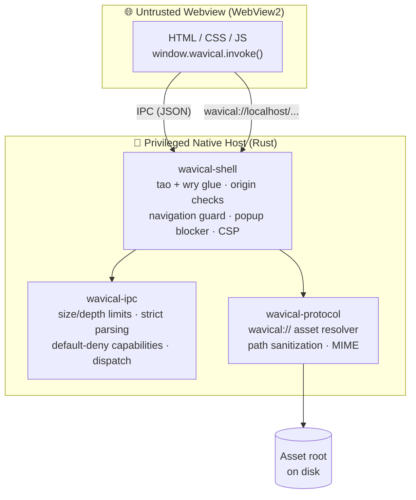

<div align="center">

# 🌊 Wavical

**A lightweight, security-first desktop app framework built in Rust.**

*Build native desktop apps with HTML, CSS, and JavaScript, without shipping a whole browser and without trusting the webview.*

[](https://github.com/dhananjay-ryu-jin-sama/Wavical/actions/workflows/ci.yml)


-yellow)

[Why Wavical](#-why-wavical) •
[Quick Start](#-quick-start) •
[Architecture](#-architecture) •
[Security Model](#-security-model) •
[JavaScript API](#-javascript-api) •
[Testing](#-testing) •
[Roadmap](#-roadmap)

</div>

---

> [!WARNING]
> **Wavical is in early pre-release development (Phase 0: Foundation Shell).** The APIs are unstable, there is no CLI yet, and Windows is the only supported platform. Don't use it in production yet. ⭐ Star or watch the repo to follow along.

---

## ✨ Why Wavical?

Electron bundles a full Chromium and Node.js runtime with every app. Tauri improved on that a lot. Wavical goes further in one direction: **assume the page is hostile, and enforce everything in compiled Rust.**

| | Principle | What it means in practice |
|:-:|---|---|
| 🪶 | **Lightweight** | Uses the OS-provided **WebView2** runtime through [`tao`](https://github.com/tauri-apps/tao) and [`wry`](https://github.com/tauri-apps/wry). No bundled browser engine. |
| 🛡️ | **Default-deny** | Every window starts with **zero** capabilities. IPC methods, origins, navigations, and popups are blocked unless explicitly allowed. |
| 🦀 | **Memory-safe** | `#![forbid(unsafe_code)]` in every crate. No `unwrap()`/`expect()` on untrusted input. |
| 🔬 | **Verified** | Unit tests, property tests (`proptest`), `cargo-fuzz` harnesses, and a live **adversarial attack page** run in CI. |
| 🤐 | **No leaks** | Errors returned to the page are generic. Internal paths, rejection reasons, and file layouts stay out of the webview. |
| 🤖 | **AI-native (planned)** | Local LLM runtimes, embedded RAG, and model management are first-class roadmap goals. |

---

## 🚀 Quick Start

### Prerequisites (Windows 10/11)

```powershell
winget install --id Git.Git -e
winget install --id Rustlang.Rustup -e
winget install --id Microsoft.VisualStudio.2022.BuildTools -e --override "--wait --passive --add Microsoft.VisualStudio.Workload.VCTools --includeRecommended"
winget install --id Microsoft.EdgeWebView2Runtime -e   # usually preinstalled on Windows 11

rustup default stable
rustup component add rustfmt clippy
```

> [!TIP]
> Restart your terminal after installing so `PATH` updates. If you see `link.exe not found`, the **Desktop development with C++** workload is missing. See [`docs/WAVICAL_SETUP.md`](docs/WAVICAL_SETUP.md) for the full setup guide.

### Run the demo app

```powershell
git clone https://github.com/dhananjay-ryu-jin-sama/Wavical.git
cd Wavical
cargo run -p wavical-shell
```

A window opens and loads [`examples/hello`](examples/hello) over the secure `wavical://` protocol. The demo lets you try the security boundary yourself:

| Button | Expected result | Enforced by |
|---|---|---|
| **Ping** → `core.ping` | ✅ Returns `{ "message": "pong", "version": "0.1.0" }` | Granted capability |
| **Echo** → `core.echo` | 🛡️ Rejected with `Method not allowed or not found` | Default-deny capability check |
| **Navigate** → `https://example.com` | 🛡️ Blocked, stays on app origin | Navigation guard |
| **Popup** → `window.open()` | 🛡️ Blocked | New-window handler |
| **Remote script** from a CDN | 🛡️ Blocked | Content-Security-Policy |

> [!NOTE]
> Run the command from the repository root. The shell looks for `examples/hello` relative to the current directory. Set `RUST_LOG=debug` to see structured security events in the console.

---

## 🏗️ Architecture

Wavical is a Cargo workspace. **Security-critical logic lives in pure crates** that don't depend on any windowing library, so it can be tested, property-tested, and fuzzed on any platform, including Linux.



### Repository layout

```text
Wavical/
├── crates/
│   ├── wavical-ipc/        # Pure: JSON-RPC parsing, limits, capabilities, handler registry
│   ├── wavical-protocol/   # Pure: wavical:// path sanitization, canonical root checks, MIME
│   └── wavical-shell/      # Window + webview host (tao/wry), wires everything together
├── examples/hello/         # Interactive demo app loaded by the shell
├── tests/
│   ├── attack-page/        # Adversarial HTML/JS that tries to break the sandbox
│   └── integration/        # Headless-style runner that drives the attack page and reports
├── fuzz/                   # cargo-fuzz targets (parse_message, capability_dispatch, resolve_path)
├── docs/                   # Security model, setup guide, build plan, feature checklist
├── .github/workflows/      # CI: Windows full workspace, Linux pure crates, supply-chain audit
├── deny.toml               # cargo-deny license / advisory / ban policy
├── ROADMAP.md
└── SECURITY.md
```

| Crate | Depends on tao/wry? | Responsibility |
|---|:-:|---|
| [`wavical-ipc`](crates/wavical-ipc) | ❌ | Message validation, `Capabilities`, `HandlerRegistry`, `dispatch` |
| [`wavical-protocol`](crates/wavical-protocol) | ❌ | `sanitize_path_segments`, `resolve_asset_path`, `get_mime_type` |
| [`wavical-shell`](crates/wavical-shell) | ✅ | `WindowConfig`, origin/navigation/popup policy, CSP headers, event loop |

---

## 🛡️ Security Model

**Golden rule: the webview is untrusted.** The JavaScript bridge is a convenience. Every check that matters happens in Rust.

<details open>
<summary><b>🔌 IPC hardening (<code>wavical-ipc</code>)</b></summary>

- **1 MB raw size limit** checked *before* any JSON parsing
- **Max nesting depth of 32**, checked on raw text and on parsed values, to stop stack-exhaustion DoS
- **Strict schema**: `{ id, method, params }` with `deny_unknown_fields`. Rejects duplicate keys, extra fields, and wrong types
- **Request IDs** must be integers in `0 ..= 2^53 − 1` (`Number.MAX_SAFE_INTEGER`)
- **Method names**: `[a-zA-Z0-9_.-]`, 1–64 bytes, no `..`, no leading or trailing separators
- **Capability check before routing.** Ungranted and non-existent methods return the *same* generic error, so a page can't probe which methods exist

</details>

<details>
<summary><b>📁 Asset protocol hardening (<code>wavical-protocol</code>)</b></summary>

Requests to `wavical://` are rejected when they contain:

- Path traversal (`..`), including single or nested percent-encoding (`%2e%2e`)
- Mixed or back slashes, drive letters (`C:`), absolute roots, UNC shares (`\\server\share`)
- NTFS Alternate Data Streams (`file:stream`, `::$DATA`)
- Windows reserved device names (`CON`, `PRN`, `AUX`, `NUL`, `COM1–9`, `LPT1–9`)
- Trailing dots or spaces, null bytes, or paths longer than 2048 bytes
- Symlink or junction escapes. The canonical path must stay inside the canonical asset root

Every rejection returns the same plain `404 Not Found` with no path details.

</details>

<details>
<summary><b>🪟 Shell-level controls (<code>wavical-shell</code>)</b></summary>

- **Origin verification** on every IPC message. Iframes and foreign origins are dropped
- **Navigation guard**: only allowlisted app origins can load top-level
- **Popup blocking**: `window.open()` gets `NewWindowResponse::Deny`
- **Strict CSP** on every response, with no `'unsafe-inline'`:
  ```text
  default-src 'self'; script-src 'self'; style-src 'self'; img-src 'self' data:;
  font-src 'self'; object-src 'none'; base-uri 'none'; frame-ancestors 'none'; form-action 'self';
  ```
- **`X-Content-Type-Options: nosniff`** on all responses
- **Frozen bridge**: `window.wavical` is defined non-writable, non-configurable, and `Object.freeze`d
- **DevTools only in debug builds** (`cfg!(debug_assertions)`)

</details>

<details>
<summary><b>📊 Structured security logging</b></summary>

Every rejected action emits a `tracing` event with a consistent `security_event` field:

| Event | Fired when |
|---|---|
| `capability_denied` | Page calls a method it wasn't granted |
| `malformed_message` | Payload fails syntax, schema, depth, or type checks |
| `oversize_message` | Raw message exceeds 1 MB |
| `origin_rejected` | IPC arrives from an unauthorized origin |
| `path_rejected` | `wavical://` path fails sanitization |
| `navigation_blocked` | Top-level navigation to an external origin |
| `popup_blocked` | Page tries to open a new window |

Logged payloads are truncated to 64 bytes on UTF-8 boundaries. Secrets are never logged.

</details>

📖 Full details: [`docs/SECURITY_MODEL.md`](docs/SECURITY_MODEL.md)

---

## 🧩 JavaScript API

Wavical injects one frozen global into every page:

```js
// Granted by default in Phase 0
const res = await window.wavical.invoke('core.ping');
console.log(res); // { message: "pong", version: "0.1.0" }

// Not granted: rejected by Rust before it reaches any handler
try {
  await window.wavical.invoke('core.echo', { hello: 'world' });
} catch (err) {
  console.error(err.message); // "Method not allowed or not found"
}
```

| Method | Default | Returns |
|---|:-:|---|
| `core.ping` | ✅ granted | `{ message: "pong", version }` |
| `core.echo` | ❌ denied | The `params` you sent (once granted) |

### Customizing a window from Rust

```rust
use wavical_shell::{run_with_config, WindowConfig};
use std::path::PathBuf;

fn main() {
    let mut config = WindowConfig::default();   // grants only core.ping
    config.capabilities.grant("core.echo");     // opt in explicitly
    config.custom_csp = None;                   // keep the strict default CSP

    run_with_config(PathBuf::from("examples/hello"), config);
}
```

> [!NOTE]
> A declarative `wavical.config.js` and a `wavical` / `wca` CLI are planned for **Phase 1**. Until then, configure windows from Rust as shown above.

---

## 🧪 Testing

Wavical follows one rule: **every security rule has a test that fails if the rule is removed.**

```powershell
# The full quality gate (the same checks CI runs)
cargo fmt --all --check
cargo clippy --workspace -- -D warnings
cargo test --workspace
cargo build --workspace

# Live adversarial test bench (opens a real WebView2 window)
cargo run -p wavical-integration-tests
```

### 🎯 Attack test bench

[`tests/attack-page`](tests/attack-page) is a hostile web page that tries to break out of the sandbox. [`tests/integration`](tests/integration) runs it in a real webview and fails the build if any attack succeeds.

| # | Attack | Expected outcome |
|:-:|---|---|
| 1 | Call ungranted `core.echo` | Generic rejection |
| 2 | Raw IPC fuzzing: malformed JSON, wrong types, unknown fields, >1 MB | Dropped, host stays responsive |
| 3 | IPC from a sandboxed cross-origin iframe | Isolated |
| 4 | External navigation and `window.open()` | Blocked |
| 5 | Path traversal through `wavical://` | `404 Not Found` |
| 6 | Load a remote CDN script | Blocked by CSP |
| 7 | Overwrite or tamper with `window.wavical` | Bridge is immutable |

### 🐛 Fuzzing (Linux / WSL)

```bash
rustup toolchain install nightly
cargo install cargo-fuzz --locked

cargo +nightly fuzz run parse_message       -- -max_total_time=60
cargo +nightly fuzz run capability_dispatch -- -max_total_time=60
cargo +nightly fuzz run resolve_path        -- -max_total_time=60
```

See [`fuzz/README.md`](fuzz/README.md) for reproducing crash artifacts.

### 🔐 Supply chain

```powershell
cargo install cargo-audit cargo-deny --locked
cargo audit
cargo deny check
```

---

## ⚙️ Continuous Integration

Every push and pull request to `main` runs three jobs in [`.github/workflows/ci.yml`](.github/workflows/ci.yml):

| Job | Runner | Checks |
|---|---|---|
| **Windows (Full Workspace)** | `windows-latest` | fmt · clippy · tests · attack bench · build |
| **Linux (Pure Crates)** | `ubuntu-latest` | fmt · clippy · tests · build for `wavical-ipc` and `wavical-protocol` |
| **Security & Supply Chain** | `ubuntu-latest` | `cargo audit` · `cargo deny check` |

---

## 🗺️ Roadmap

| Phase | Focus | Status |
|:-:|---|:-:|
| **0** | Foundation shell: window, `wavical://` protocol, secure IPC, CSP, test bench | 🚧 In progress |
| **1** | `wavical` / `wca` CLI (`init`, `dev`, `build`), `wavical.config.js`, capability manifest | 📋 Planned |
| **2** | Native APIs: dialogs, clipboard, notifications, tray, shortcuts, single-instance | 📋 Planned |
| **3** | **AI-native**: local llama.cpp/GGUF, embedded RAG (`ai.index`, `ai.search`), `wavical model pull` | 📋 Planned |
| **4** | Opt-in shared Node/Bun runtime, signed delta auto-updates | 📋 Planned |
| **5** | Installers (`.exe`/`.msi`), code signing, portable builds, public benchmarks | 📋 Planned |
| **6** | Enterprise: audit logging, SBOM, `wavical audit`, private registries | 📋 Planned |

Full breakdown: [`ROADMAP.md`](ROADMAP.md) · Scope: [`docs/WAVICAL_FEATURE_CHECKLIST.md`](docs/WAVICAL_FEATURE_CHECKLIST.md)

---

## 🤝 Contributing

Contributions, ideas, and security reviews are welcome. Before opening a PR, please check:

1. **No `unsafe`.** `#![forbid(unsafe_code)]` stays in place.
2. **No panics on untrusted input.** Don't use `unwrap()`, `expect()`, or panicking indexing on IPC, URL, path, or JSON data. Use `thiserror`.
3. **Security logic stays in the pure crates** (`wavical-ipc`, `wavical-protocol`), never in tao/wry glue.
4. **Generic errors go to the page.** Log details with `tracing`.
5. **Tests ship with the code.** New security rules need a test that fails without them.
6. **The quality gate passes**: `fmt`, `clippy -D warnings`, `test`, `build`.
7. **Add dependencies with `cargo add`.** Don't pin versions by hand.

---

## 🔒 Reporting Vulnerabilities

Please **don't** open public issues for security problems. Use GitHub's **Private Vulnerability Reporting** in the *Security* tab. See [`SECURITY.md`](SECURITY.md) for details.

---

## 📚 Documentation

| Document | Description |
|---|---|
| [`docs/SECURITY_MODEL.md`](docs/SECURITY_MODEL.md) | Trust boundaries, enforcement layers, logging |
| [`docs/WAVICAL_SETUP.md`](docs/WAVICAL_SETUP.md) | Full Windows and WSL dev environment setup |
| [`docs/WAVICAL_PHASE_0_BUILD_PLAN.md`](docs/WAVICAL_PHASE_0_BUILD_PLAN.md) | Phase 0 work packages and scope |
| [`docs/WAVICAL_FEATURE_CHECKLIST.md`](docs/WAVICAL_FEATURE_CHECKLIST.md) | Overall feature scope |
| [`ROADMAP.md`](ROADMAP.md) | Phased delivery plan |
| [`SECURITY.md`](SECURITY.md) | Vulnerability disclosure policy |

---

## 📄 License

Dual-licensed under either of

- **MIT License**
- **Apache License, Version 2.0**

at your option.

Unless you explicitly state otherwise, any contribution you intentionally submit for inclusion in this work, as defined in the Apache-2.0 license, is dual-licensed as above, without any additional terms or conditions.

---

<div align="center">

**Built with 🦀 Rust · [tao](https://github.com/tauri-apps/tao) · [wry](https://github.com/tauri-apps/wry) · WebView2**

*Small binaries. Strict boundaries. No trust in the page.*

</div>
