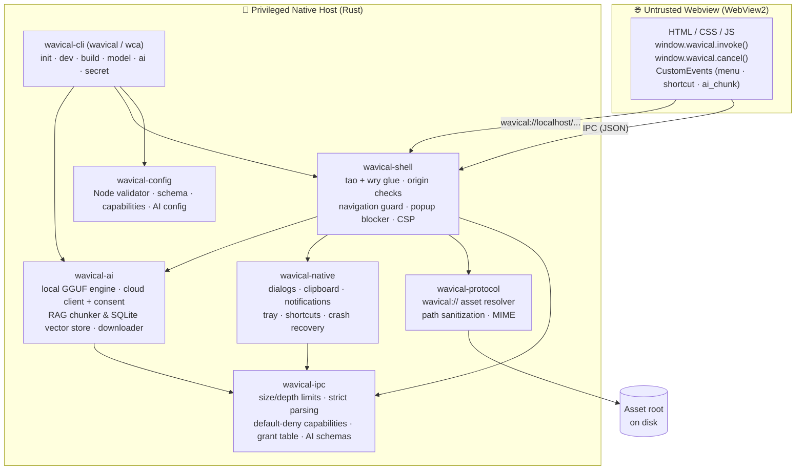

<div align="center">

# 🌊 Wavical

**A lightweight, security-first, AI-native desktop app framework built in Rust.**

*Build native desktop apps with HTML, CSS, and JavaScript, without shipping a whole browser and without trusting the webview.*

[](https://github.com/dhananjay-ryu-jin-sama/Wavical/actions/workflows/ci.yml)


-blue)

[Why Wavical](#-why-wavical) •
[Quick Start](#-quick-start) •
[Architecture](#-architecture) •
[Security Model](#-security-model) •
[JavaScript API](#-javascript-api) •
[Testing](#-testing) •
[Roadmap](#-roadmap)

</div>

---

> [!NOTE]
> **Wavical is in active pre-release development (Phases 0–3 complete; hardware benchmark validation in progress).** The foundational shell, developer CLI (`wavical` / `wca`), hot-reload dev server, build pipeline, Native Tier 1 APIs (scoped file dialogs & grant tables, clipboard, desktop notifications, system tray, native context menus, global shortcuts, single-instance lock, crash recovery, and Windows file associations), and **AI-Native Infrastructure** (`wavical-ai`: local GGUF inference, cloud fallback with consent & credential store, embedded RAG `ai.index`/`ai.search`, `wavical model` CLI, `wavical ai doctor`/`bench`, and `wavical init --ai`) are operational. Windows is currently the primary supported desktop runtime. ⭐ Star or watch the repo to follow along.

---

## ✨ Why Wavical?

Electron bundles a full Chromium and Node.js runtime with every app. Tauri improved on that a lot. Wavical goes further in two directions: **assume the page is hostile (enforcing everything in compiled Rust)**, and **make local-first AI a native, capability-gated primitive.**

| | Principle | What it means in practice |
|:-:|---|---|
| 🪶 | **Lightweight** | Uses the OS-provided **WebView2** runtime through [`tao`](https://github.com/tauri-apps/tao) and [`wry`](https://github.com/tauri-apps/wry). No bundled browser engine. |
| 🛡️ | **Default-deny** | Every window starts with **zero** capabilities. IPC methods, origins, navigations, popups, native APIs, and AI calls are blocked unless explicitly allowed. |
| 🔑 | **Scoped file access** | The webview **never** touches a raw file path. Files chosen via native dialogs yield opaque, mode-scoped (`ReadOnly` / `WriteOnly`) 128-bit grant tokens verified in Rust at time-of-use. |
| 🤖 | **AI-native** | Opt-in local GGUF inference over anonymous pipes (zero network sockets), cloud fallback with interactive user consent, embedded local RAG (`ai.index`, `ai.search`), and SHA-256 verified model pulls (`wavical model pull`). |
| 🦀 | **Memory-safe** | `#![forbid(unsafe_code)]` in pure and AI crates (`wavical-ipc`, `wavical-protocol`, `wavical-config`, `wavical-cli`, `wavical-ai`, `wavical-shell`). |
| 🔬 | **Verified** | 400+ unit, integration, property (`proptest`), and black-box security audit tests (`A0`–`A7`), 8 `cargo-fuzz` harnesses, and a live **adversarial attack page** run in CI. |
| 🤐 | **No leaks** | Errors returned to the page are generic. Internal paths, API keys, prompts, rejection reasons, and file layouts stay out of the webview and logs. |

---

## 🚀 Quick Start

### Prerequisites (Windows 10/11)

```powershell
winget install --id Git.Git -e
winget install --id Rustlang.Rustup -e
winget install --id Microsoft.VisualStudio.2022.BuildTools -e --override "--wait --passive --add Microsoft.VisualStudio.Workload.VCTools --includeRecommended"
winget install --id Microsoft.EdgeWebView2Runtime -e   # usually preinstalled on Windows 11
winget install --id OpenJS.NodeJS -e                   # Node.js (>= 14.8.0, required for CLI evaluation of wavical.config.js)

rustup default stable
rustup component add rustfmt clippy
```

> [!TIP]
> Restart your terminal after installing so `PATH` updates. If you see `link.exe not found`, the **Desktop development with C++** workload is missing. See [`docs/WAVICAL_SETUP.md`](docs/WAVICAL_SETUP.md) for the full setup guide.

### 1. Using the Developer CLI (`wavical` / `wca`)

Clone and build or install the CLI locally:

```powershell
git clone https://github.com/dhananjay-ryu-jin-sama/Wavical.git
cd Wavical

# Option A: Install CLI tools into your Cargo bin directory
cargo install --path crates/wavical-cli

# Scaffold a new app (both `wavical` and shorthand `wca` work identically)
wavical init my-app
cd my-app

# Or scaffold an app with AI assistance (validates paths/sizes, defaults to zero granted capabilities)
wavical init my-ai-app --ai "Create a local markdown note-taking app"

# Start the interactive dev server (watches assets & config with hot-reload)
wavical dev

# Build production-ready assets with SHA-256 manifest
wavical build

# Register or unregister Windows file associations declared in config (HKCU OpenWithProgids)
wavical register-filetypes
wavical unregister-filetypes
```

### 2. Managing AI Models, Diagnostics & Cloud Secrets

```powershell
# Inspect CPU SIMD extensions (AVX2/FMA), RAM, disk space, and AI engine readiness (100% offline)
wavical ai doctor

# List approved catalog models and local installation status
wavical model list

# Pull a verified GGUF model from upstream Hugging Face (prompts for explicit license agreement)
wavical model pull qwen2.5-1.5b-instruct
wavical model pull bge-small-en-v1.5 --accept-license MIT

# Verify SHA-256 integrity & GGUF headers, or remove a local model
wavical model verify qwen2.5-1.5b-instruct
wavical model remove qwen2.5-1.5b-instruct

# Store or clear a cloud provider API key in the Windows Credential Store
wavical secret set api.openai.com
wavical secret clear api.openai.com

# Run reproducible local Chat & RAG performance benchmarks
wavical ai bench --rag-only --runs 5 --warmup 1
```

### 3. Run the Interactive Security, Native & AI Demo App

```powershell
# From the repository root:
cargo run -p wavical-shell
```

A window opens and loads [`examples/hello`](examples/hello) over the secure `wavical://` protocol. The demo lets you test the security boundary, Native Tier 1 APIs, and local AI chat interactively:

| Feature / Action | Expected Result | Enforced By |
|---|---|---|
| **Ping** → `core.ping` | ✅ Returns `{ "message": "pong", "version": "0.1.0" }` | Granted capability |
| **Echo** → `core.echo` | 🛡️ Rejected with `Method not allowed or not found` | Default-deny capability check |
| **Clipboard** → `clipboard.write` / `read` | ✅ Copies/pastes text (max 1 MB payload) | `wavical-native` + capability check |
| **Desktop Notifications** → `notify.send` | ✅ Emits native OS notification (rate-limited: 5 / 10s) | `wavical-native` (`notify-rust`) |
| **File Dialog** → `dialog.openFile` / `saveFile` | 🔑 Returns opaque `grantId`, **never raw path** | Mode-scoped `GrantTable` token |
| **Scoped Read/Write** → `fs.readGranted` / `writeGranted` | ✅ Reads/writes file by `grantId` (re-validated, max 10 MB) | Rust handle & path re-validation guard |
| **Raw Path Injection Attack** | 🛡️ Rejected: raw paths rejected by strict schema | `deny_unknown_fields` on IPC |
| **System Tray & Menus** → `tray.set` / `menu.showContextMenu` | ✅ Native tray icon, tooltip, and popup menus (max 200 items) | `muda` + `tray-icon` on UI thread |
| **Global Shortcuts** → `shortcut.register` | ✅ Registers global key accelerator (e.g. `Ctrl+Shift+K`) | `global-hotkey` + event bridge |
| **AI Chat (Streaming)** → `ai.chat` / `ai.cancel` | 🤖 Streams tokens into `textContent` with live cancellation | `wavical-ai` + per-window concurrency guard |
| **Navigate** → `https://example.com` | 🛡️ Blocked, stays on app origin | Navigation guard |
| **Popup** → `window.open()` | 🛡️ Blocked (`NewWindowResponse::Deny`) | New-window handler |
| **Remote script** from a CDN | 🛡️ Blocked | Content-Security-Policy |

> [!NOTE]
> Run `cargo run -p wavical-shell` from the repository root. The shell loads `examples/hello` relative to the current directory. Set `RUST_LOG=debug` to see structured security events in the console.

---

## 🏗️ Architecture

Wavical is organized as a modular Cargo workspace. **Security-critical validation lives in pure crates** that don't depend on any windowing library, so it can be unit-tested, property-tested, and fuzzed on any platform, including Linux.



### Repository layout

```text
Wavical/
├── crates/
│   ├── wavical-ai/         # Phase 3 AI: model catalog, downloader, GGUF engine, cloud client, RAG store, doctor, bench
│   ├── wavical-cli/        # Developer CLI (wavical, wca): init (--ai), dev, build, model, ai, secret, filetypes
│   ├── wavical-config/     # Node-evaluated config loader, schema validator, capability & AI gating
│   ├── wavical-ipc/        # Pure: JSON-RPC parsing, limits, capabilities, grant table, native & AI schemas
│   ├── wavical-native/     # Native Tier 1: dialogs (rfd), clipboard (arboard), notify, tray, shortcuts, single-instance
│   ├── wavical-protocol/   # Pure: wavical:// path sanitization, canonical root checks, MIME
│   └── wavical-shell/      # Window + webview host (tao/wry), isolated WebView2 profile, IPC & AI bridge
├── examples/hello/         # Interactive demo app with Phase 0, Phase 2 & Phase 3 capability tests
├── tests/
│   ├── attack-page/        # Adversarial HTML/JS that tries to break the sandbox
│   ├── integration/        # Automated runner that drives the attack page in a real WebView2 instance
│   └── audit/              # Independent black-box security audit test suite (A0–A7)
├── fuzz/                   # 8 cargo-fuzz targets (IPC, protocol, grants, native, AI, catalog, chunker)
├── docs/                   # Security model, AI privacy & security reviews, phase plans, audits, checklist
├── models.json             # Pinned model catalog with SHA-256 digests and upstream Hugging Face URLs
├── .github/workflows/      # CI: Windows full workspace, Linux pure/AI crates, CLI E2E, supply-chain audit
├── deny.toml               # cargo-deny license / advisory / ban policy
├── ROADMAP.md
└── SECURITY.md
```

| Crate | Depends on tao/wry? | Responsibility |
|---|:-:|---|
| [`wavical-ai`](crates/wavical-ai) | ❌ | Verified model catalog & downloader, license prompt, local GGUF engine manager (stdio pipes + Job Objects), cloud client with consent & Windows Credential Store, RAG chunker/embeddings/SQLite store, `ai doctor`, `ai bench` |
| [`wavical-cli`](crates/wavical-cli) | ❌ | CLI interface (`wavical` & `wca`), project scaffolding (`init`, `init --ai`), dev watcher (`dev`), asset packaging (`build`), filetype registration, `model`, `ai`, and `secret` commands |
| [`wavical-config`](crates/wavical-config) | ❌ | Evaluates `wavical.config.js` via isolated Node subprocess, enforces schema, `ai.enabled` capability gating, and Levenshtein typo suggestions |
| [`wavical-ipc`](crates/wavical-ipc) | ❌ | Message validation, `Capabilities`, mode-scoped `GrantTable`, `HandlerRegistry`, `NativeHandler`, AI request/response schemas & boundary validators |
| [`wavical-native`](crates/wavical-native) | ✅ (Windows) | Dialogs (`rfd`), clipboard (`arboard`), notifications (`notify-rust`), tray (`tray-icon`), menus (`muda`), shortcuts (`global-hotkey`), single-instance (`interprocess`), window state, crash recovery |
| [`wavical-protocol`](crates/wavical-protocol) | ❌ | `sanitize_path_segments`, `resolve_asset_path`, `get_mime_type` |
| [`wavical-shell`](crates/wavical-shell) | ✅ | `WindowConfig`, per-app WebView2 data directory isolation, origin/navigation/popup policy, CSP headers, event loop, native & AI delegate glue |

---

## 🛡️ Security Model

**Golden rule: the webview is untrusted.** The JavaScript bridge is a convenience. Every check that matters happens in Rust.

<details open>
<summary><b>🔑 Scoped file access & grant tables (<code>wavical-ipc</code> & <code>wavical-native</code>)</b></summary>

The webview **never** passes a file path to `fs.*`. File paths are never accepted from JavaScript.

- **Explicit User Action**: File paths enter the host *only* when the user picks a file through an OS-native dialog (`dialog.openFile` or `dialog.saveFile`).
- **Opaque, Mode-Scoped Grant IDs**: Rust stores chosen paths inside a per-window `GrantTable` with strict permission scoping (`GrantMode::ReadOnly` for open dialogs, `GrantMode::WriteOnly` for save dialogs) and returns an unguessable 128-bit CSPRNG hex grant ID to JavaScript.
- **Time-of-Use & Handle Verification**: When `fs.readGranted` or `fs.writeGranted` is called:
  - Validates that `grantId` is a 32-char hex token owned by the calling window and permitted for the requested mode (read vs. write).
  - Re-checks that target path contains no null bytes, Windows reserved device names (`CON`, `PRN`, `NUL`, `CONIN$`, `CONOUT$`, etc.), trailing dots/spaces, or NTFS Alternate Data Streams (`::$DATA`).
  - Re-checks that target is a regular file and **not** a symlink or junction.
  - Verifies that the current canonical path still matches the canonical path recorded at grant time.
  - Writes atomically via a sibling `.tmp` file with restrictive Win32 share flags (`FILE_SHARE_READ`) and `sync_all()` before rename, preventing TOCTOU swaps and in-place file truncation.
  - Enforces a hard **10 MB payload limit** on reads and writes.
- **Per-Window Isolation**: Grants are capped at 64 per window, scoped to their window ID, cleared on window close, and can never cross windows.

</details>

<details open>
<summary><b>🤖 AI security, privacy & secret isolation (<code>wavical-ai</code> & <code>wavical-ipc</code>)</b></summary>

- **Double Opt-In Gating**: Any `ai.*` capability (`ai.chat`, `ai.index`, `ai.search`) is rejected at config validation and IPC dispatch unless `ai.enabled: true` is also set in `wavical.config.js`.
- **Zero Network Calls in Local Mode**: When `ai.mode` is `'local'`, Wavical makes **zero** outbound network connections. The local inference engine communicates strictly over anonymous `stdin`/`stdout` pipes—never loopback TCP or named pipes.
- **Engine Integrity & Process Containment**:
  - The engine binary SHA-256 digest is verified before **every** launch; a 1-byte modification aborts startup.
  - On Windows, the engine runs inside a Win32 Job Object (`JOB_OBJECT_LIMIT_KILL_ON_JOB_CLOSE`) so it cannot outlive the parent shell, and automatically shuts down after configurable idle inactivity.
- **Cloud Pinning & Interactive User Consent**:
  - Cloud endpoints require `https://`, reject embedded userinfo (`@`), and enforce `reqwest::redirect::Policy::none()` (all HTTP 301/302/307/308 redirects are refused closed).
  - Before the first cloud request, a native OS modal dialog (`rfd`) prompts the user for explicit consent; the webview cannot forge or bypass consent.
  - In `local-first` mode, fallback to cloud occurs *only* on local engine unavailability, never on content refusals.
- **API Key Isolation & Redaction**:
  - Config only accepts an environment variable name in `apiKeyEnv` (e.g. `"OPENAI_API_KEY"`); raw key-shaped values (`sk-...`, `AIza...`, long tokens) in config are rejected at validation time.
  - Keys are loaded in Rust from the Windows Credential Store (`wavical secret set`) or environment, wrapped in `CloudApiKey` with `[REDACTED]` `Debug`/`Display` impls, stripped from child engine environments, and never written to disk, logs, or IPC responses.
- **Prompt & Document Privacy**: Prompts, completions, search queries, and indexed document text are **never** written to `tracing` logs. AI telemetry events (`ai.call.started`, `ai.call.finished`, etc.) record only character counts, durations, and status codes.
- **Webview Cannot Manage Models**: The webview has no IPC method to pull, delete, or verify models, nor to accept model licenses.

</details>

<details>
<summary><b>🔌 IPC hardening (<code>wavical-ipc</code>)</b></summary>

- **1 MB raw size limit** checked *before* any JSON parsing
- **Max nesting depth of 32**, checked on raw text and on parsed values, to stop stack-exhaustion DoS
- **Strict schema**: `{ id, method, params }` with `deny_unknown_fields`. Rejects duplicate keys, extra fields, and wrong types
- **Request IDs** must be integers in `0 ..= 2^53 − 1` (`Number.MAX_SAFE_INTEGER`)
- **Method names**: `[a-zA-Z0-9_.-]`, 1–64 bytes, no `..`, no leading or trailing separators
- **Capability check before routing.** Ungranted and non-existent methods return the *same* generic error (`Method not allowed or not found`), preventing method probing
- **Strict parameter validation limits**:
  - Clipboard text: max 1 MB
  - Notification title: max 128 chars; body: max 1024 chars; max 5 notifications per 10s per window
  - Context menu items: max 200 items; global shortcuts: max 32 registered per app
  - AI Chat: max 50 messages, 32,000 chars/message, 128,000 total chars, `maxTokens` ≤ 4,096, 1 concurrent generation per window
  - AI RAG: max 16 collections/app, 100 docs/index call, 100,000 chars/doc, 4 KB flat metadata, 50,000 chunks/collection, 512 MB index file ceiling

</details>

<details>
<summary><b>📁 Asset protocol hardening (<code>wavical-protocol</code>)</b></summary>

Requests to `wavical://` are rejected when they contain:

- Path traversal (`..`), including single or nested percent-encoding (`%2e%2e`)
- Mixed or back slashes, drive letters (`C:`), absolute roots, UNC shares (`\\server\share`)
- NTFS Alternate Data Streams (`file:stream`, `::$DATA`)
- Windows reserved device names (`CON`, `PRN`, `AUX`, `NUL`, `CONIN$`, `CONOUT$`, `COM1–9`, `LPT1–9`)
- Trailing dots or spaces, null bytes, or paths longer than 2048 bytes
- Symlink or junction escapes. The canonical path must stay inside the canonical asset root

Every rejection returns the same plain `404 Not Found` with no path details.

</details>

<details>
<summary><b>🪟 Shell-level controls (<code>wavical-shell</code>)</b></summary>

- **Origin verification** on every IPC message. Iframes and foreign origins are dropped
- **Navigation guard**: only allowlisted app origins can load top-level
- **Popup blocking**: `window.open()` gets `NewWindowResponse::Deny`
- **Strict CSP** on every response, with no `'unsafe-inline'`:
  ```text
  default-src 'self'; script-src 'self'; style-src 'self'; img-src 'self' data:;
  font-src 'self'; connect-src 'self'; frame-src 'none'; object-src 'none';
  base-uri 'none'; frame-ancestors 'none'; form-action 'self';
  ```
- **`X-Content-Type-Options: nosniff`** on all responses
- **Frozen minimal bridge**: `window.wavical` is defined non-writable, non-configurable, and `Object.freeze`d, exposing only `invoke` and `cancel`
- **Per-app WebView2 profile isolation**: browser storage is isolated under `%LOCALAPPDATA%\wavical\<appId>\EBWebView`
- **Single-instance locking**: prevents conflicting processes via named local IPC pipes
- **Webview crash recovery**: rate-limited auto-reload (single reload within 30s) on WebView2 renderer process failure
- **DevTools & stdin reload gated in release**: enabled only in debug builds (`cfg!(debug_assertions)`)

</details>

<details>
<summary><b>⚙️ Config execution trust model (<code>wavical.config.js</code>)</b></summary>

Wavical evaluates `wavical.config.js` via Node.js during developer CLI workflows (`wavical dev` and `wavical build`).

> [!WARNING]
> Because `wavical.config.js` is an executable JavaScript module, it executes arbitrary code with the local developer's user permissions and privileges. Downloading third-party repositories and executing `wavical dev` without inspecting the config carries arbitrary code execution risks. Always review `wavical.config.js` before running CLI commands on untrusted projects.

</details>

<details>
<summary><b>⚖️ AI Model Licensing & Responsibility</b></summary>

Wavical is a software framework and runtime platform, **not** a model distributor or license enforcer:

- **Direct Upstream Fetching**: Models are never bundled or mirrored by Wavical. Calling `wavical model pull <id>` downloads weights directly from their official upstream source (such as Hugging Face) and verifies their SHA-256 digest against [`models.json`](models.json).
- **Explicit License Acknowledgment**: Before any model download begins, the CLI displays the model's license identifier and official license URL and requires explicit acknowledgment (`AGREE` interactively or `--accept-license <LICENSE_ID>`).
- **Developer & Organization Responsibility**: Developers and companies downloading, using, or shipping applications with a given AI model bear sole responsibility for reviewing and complying with that model's upstream license terms and acceptable use policies.

</details>

📖 Full details: [`docs/SECURITY_MODEL.md`](docs/SECURITY_MODEL.md) · [`docs/AI_PRIVACY.md`](docs/AI_PRIVACY.md) · [`docs/AI_SECURITY_REVIEW.md`](docs/AI_SECURITY_REVIEW.md)

---

## 🧩 JavaScript API

Wavical injects one frozen global object (`window.wavical`) into every loaded page:

```js
// 1. Invoke IPC methods (Returns a Promise)
const res = await window.wavical.invoke('core.ping');
console.log(res); // { message: "pong", version: "0.1.0" }

// 2. Stream AI chat tokens (3rd argument is an optional chunk callback)
const chatRes = await window.wavical.invoke(
  'ai.chat',
  {
    messages: [{ role: 'user', content: 'Explain Rust ownership in 2 sentences.' }],
    maxTokens: 256,
    temperature: 0.7,
    stream: true,
  },
  (chunk) => {
    // Always render model output via textContent, never innerHTML
    document.getElementById('chat-output').textContent += chunk;
  }
);

// 3. Cancel an in-flight AI generation for this window
await window.wavical.cancel(1);

// 4. Listen for native menu and global shortcut events via CustomEvent
window.addEventListener('wavical:menu', (e) => {
  console.log('Menu item clicked:', e.detail.id);
});
```

### Supported IPC Methods & Capabilities

All capabilities are **default-deny** (omitted or `false` in config means denied):

| Method / Capability | Default | Parameters | Description |
|---|:-:|---|---|
| `core.ping` | ✅ granted | none | Health check. Returns `{ message: "pong", version }`. |
| `core.echo` | ❌ denied | `any` | Echo back params (used to verify capability gating). |
| `clipboard.read` | ❌ denied | none | Reads text from system clipboard (max 1 MB). |
| `clipboard.write` | ❌ denied | `{ text: string }` | Writes text to system clipboard (max 1 MB). |
| `notify.send` | ❌ denied | `{ title: string, body?: string }` | Shows native desktop notification (title ≤128, body ≤1024 chars, max 5/10s). |
| `dialog.openFile` | ❌ denied | `{ title?: string, filterId?: string }` | Opens native file picker. Returns `{ cancelled: bool, grantId?: string }` (`ReadOnly`). |
| `dialog.saveFile` | ❌ denied | `{ title?: string, defaultName?: string, filterId?: string }` | Opens native save picker. Returns `{ cancelled: bool, grantId?: string }` (`WriteOnly`). |
| `fs.readGranted` | ❌ denied | `{ grantId: string }` | Reads UTF-8 text from a `ReadOnly` granted file (max 10 MB). **Never accepts paths.** |
| `fs.writeGranted` | ❌ denied | `{ grantId: string, content: string }` | Atomically writes UTF-8 text to a `WriteOnly` granted file (max 10 MB). **Never accepts paths.** |
| `menu.showContextMenu` | ❌ denied | `{ items: MenuItem[] }` | Displays native context menu at cursor (max 200 items). |
| `tray.set` | ❌ denied | `{ tooltip?: string, items?: MenuItem[] }` | Sets system tray icon tooltip and menu items. |
| `shortcut.register` | ❌ denied | `{ shortcut: string } \| { shortcuts: string[] }` | Registers global accelerator shortcuts (max 32). |
| `badge.set` | ❌ denied | `{ count: number \| null }` | Validates taskbar badge count (`0..=99` / `99+`); OS COM rendering deferred (`F-A0-10`). |
| `ai.chat` | ❌ denied | `{ messages: ChatMessage[], maxTokens?: number, temperature?: number, stream?: bool }` | Runs local or cloud chat completion (requires `ai.enabled: true`). Also enables `ai.cancel`. |
| `ai.index` | ❌ denied | `{ action: 'add' \| 'replace' \| 'delete', collection: string, documents?: Document[] }` | Chunks, embeds, and indexes (or deletes) documents in the per-app local vector store. |
| `ai.search` | ❌ denied | `{ collection: string, query: string, topK?: number }` | Performs semantic cosine-similarity search (`topK` 1–20) over a local collection. |

### Example: Local Semantic Search (RAG) in Frontend

```javascript
// 1. Index documents into a named collection
await window.wavical.invoke('ai.index', {
  action: 'add',
  collection: 'project-notes',
  documents: [
    {
      id: 'note-1',
      text: 'Wavical enforces default-deny capabilities in compiled Rust.',
      metadata: { tag: 'security', pinned: true }
    }
  ]
});

// 2. Query the collection by semantic similarity
const searchResult = await window.wavical.invoke('ai.search', {
  collection: 'project-notes',
  query: 'How are permissions enforced?',
  topK: 3
});

for (const hit of searchResult.hits) {
  console.log(hit.id, hit.score, hit.text);
}
```

### Declarative Configuration (`wavical.config.js`)

Applications are configured using a single flat `wavical.config.js` file at the project root:

```javascript
/** @type {import('wavical-config').AppConfig} */
export default {
  appId: 'my-app',
  version: '0.1.0',
  window: {
    title: 'My App',
    width: 1200,
    height: 800,
    persistState: true,
  },
  singleInstance: true,
  ai: {
    enabled: true,
    mode: 'local', // 'local' | 'cloud' | 'local-first'
    local: {
      chatModel: 'qwen2.5-1.5b-instruct',
      embedModel: 'bge-small-en-v1.5',
      contextSize: 4096,
      maxTokens: 1024,
      idleMinutes: 10,
      threads: 'auto',
    },
  },
  capabilities: {
    // Phase 0 Core
    'core.ping': true,
    'core.echo': false,

    // Phase 2 Native Tier 1 APIs
    'clipboard.read': true,
    'clipboard.write': true,
    'notify.send': true,
    'dialog.openFile': true,
    'dialog.saveFile': true,
    'fs.readGranted': true,
    'fs.writeGranted': true,
    'menu.showContextMenu': true,
    'tray.set': true,
    'shortcut.register': true,

    // Phase 3 AI-Native APIs (requires ai.enabled: true)
    'ai.chat': true,
    'ai.index': true,
    'ai.search': true,
  },
  shortcuts: ['Ctrl+Shift+K'],
  fileAssociations: ['wca'],
  tray: {
    icon: 'icon.png',
  },
  dialog: {
    filters: {
      text: { name: 'Text Documents', extensions: ['txt', 'md', 'json'] },
    },
  },
  dev: {
    port: 7890,
  },
};
```

---

## 🧪 Testing

Wavical follows one rule: **every security rule has a test that fails if the rule is removed.**

```powershell
# The full quality gate (the same checks CI runs across all crates)
cargo fmt --all --check
cargo clippy --workspace --all-targets -- -D warnings
cargo test --workspace
cargo build --workspace

# Run the AI subsystem test suite (106 unit & integration tests with fake engine & mock servers)
cargo test -p wavical-ai

# Run the independent black-box security audit test suite (Phases 0, 1, 2, and 3)
cargo test -p wavical-audit

# Live adversarial test bench (opens a real WebView2 window and runs 13 sandbox escape vectors)
cargo run -p wavical-integration-tests
```

### 📋 Independent Security Audits

Formal black-box security audit reports and regression suites (`tests/audit`) are stored under [`docs/audits/`](docs/audits/):
- **[A0–A6: Phase 0, 1 & 2 Security & Mutation Audits](docs/audits/phase%201%20and%202/A6_summary.md)** — Covers baseline & supply chain (`A0`), pure crates (`A1a`), shell isolation (`A1b`), CLI & config (`A2`), native core & grants (`A3a`), tray/shortcuts/filetypes (`A3b`), red-team (`A4`), and `cargo-mutants` mutation testing (`A5`).
- **[A7: Phase 3 AI-Native Infrastructure Security Audit](docs/audits/phase%203/A7_phase3.md)** — Evaluates 54 requirements across local network purity (zero sockets), secret redaction, prompt privacy, downloader hash/host pinning, Job Object lifecycle, RAG injection resistance, and red-team webview attacks.

### 🐛 Fuzzing (Linux / WSL)

8 `libFuzzer` targets in [`fuzz/`](fuzz/) continuously test parsers and security boundaries:

```bash
rustup toolchain install nightly
cargo install cargo-fuzz --locked

cargo +nightly fuzz run parse_message         -- -max_total_time=60
cargo +nightly fuzz run capability_dispatch   -- -max_total_time=60
cargo +nightly fuzz run resolve_path          -- -max_total_time=60
cargo +nightly fuzz run native_request_parser -- -max_total_time=60
cargo +nightly fuzz run grant_table           -- -max_total_time=60
cargo +nightly fuzz run ai_request_parser     -- -max_total_time=60
cargo +nightly fuzz run catalog_parser        -- -max_total_time=60
cargo +nightly fuzz run chunker               -- -max_total_time=60
```

See [`docs/FUZZING.md`](docs/FUZZING.md) and [`fuzz/README.md`](fuzz/README.md) for reproducing crash artifacts.

### 🔐 Supply chain

```powershell
cargo install cargo-audit cargo-deny --locked
cargo audit
cargo deny check
```

---

## ⚙️ Continuous Integration

Every push and pull request to `main` runs in [`.github/workflows/ci.yml`](.github/workflows/ci.yml):

| Job | Runner | Checks |
|---|---|---|
| **Windows (Full Workspace)** | `windows-latest` | fmt · clippy · full workspace unit & property tests · `wavical-ai` tests · live WebView2 attack bench · workspace build |
| **Linux (Pure, Catalog & Chunker)** | `ubuntu-latest` | fmt · clippy · tests for `wavical-ipc`, `wavical-protocol`, `wavical-config`, `wavical-cli`, and `wavical-ai` (`catalog`, `chunker`, `rag_tests`) |
| **CLI E2E Workflow & Smoke** | `ubuntu-latest` | `wavical` / `wca` help smoke checks · `wavical init` scaffold · `wavical build` · SHA-256 `wavical-manifest.json` verification |
| **Security & Supply Chain** | `ubuntu-latest` | `cargo audit` · `cargo deny check` |

---

## 🗺️ Roadmap

| Phase | Focus | Status |
|:-:|---|:-:|
| **0** | Foundation shell: window (`tao`/`wry`), `wavical://` protocol, secure IPC, CSP, attack bench | ✅ Completed |
| **1** | `wavical` / `wca` CLI (`init`, `dev`, `build`), `wavical.config.js`, hot-reload, SHA-256 manifest | ✅ Completed |
| **2** | **Native Tier 1 APIs**: dialogs (`rfd`), clipboard (`arboard`), notifications (`notify-rust`), tray (`tray-icon`), menus (`muda`), shortcuts (`global-hotkey`), single-instance (`interprocess`), crash recovery | ✅ Completed |
| **3** | **AI-native**: local llama.cpp/GGUF, cloud fallback + consent, embedded RAG (`ai.index`, `ai.search`), `wavical model`, `wavical ai doctor`/`bench`, `wavical init --ai` | ✅ Core Complete *(8 GB hardware benchmark run pending)* |
| **4** | Opt-in shared Node/Bun runtime, signed delta auto-updates | 📋 Planned |
| **5** | Installers (`.exe`/`.msi`), code signing, portable builds, public benchmarks | 📋 Planned |
| **6** | Enterprise: audit logging, SBOM, `wavical audit`, private registries | 📋 Planned |

Full breakdown: [`ROADMAP.md`](ROADMAP.md) · Scope: [`docs/WAVICAL_FEATURE_CHECKLIST.md`](docs/WAVICAL_FEATURE_CHECKLIST.md)

---

## 🤝 Contributing

Contributions, ideas, and security reviews are welcome. Before opening a PR, please check:

1. **No `unsafe` in pure or AI crates.** `#![forbid(unsafe_code)]` stays in place.
2. **No panics on untrusted input.** Don't use `unwrap()`, `expect()`, or panicking indexing on IPC, URL, path, or JSON data. Use `thiserror`.
3. **Security logic stays in pure crates** (`wavical-ipc`, `wavical-protocol`, `wavical-config`, `wavical-cli`, `wavical-ai`), never in tao/wry glue.
4. **Generic errors go to the page.** Log details with `tracing` (never log prompts, document contents, raw file paths, or secrets).
5. **Tests ship with the code.** New security rules need a test that fails without them.
6. **The quality gate passes**: `fmt`, `clippy -D warnings`, `test`, `build`.
7. **Add dependencies with `cargo add`.** Don't pin versions by hand.

---

## 🔒 Reporting Vulnerabilities

Please **don't** open public issues for security problems. Use GitHub's **Private Vulnerability Reporting** in the *Security* tab. See [`SECURITY.md`](SECURITY.md) for details.

---

## 📚 Documentation

| Document | Description |
|---|---|
| [`docs/SECURITY_MODEL.md`](docs/SECURITY_MODEL.md) | Master trust boundaries, enforcement layers, IPC & AI limits, and logging |
| [`docs/AI_PRIVACY.md`](docs/AI_PRIVACY.md) | Local vs. cloud data flows, prompt privacy, credential storage, and model licensing |
| [`docs/AI_SECURITY_REVIEW.md`](docs/AI_SECURITY_REVIEW.md) | Hostile security review and threat model for the Phase 3 AI subsystem |
| [`docs/AI_BENCHMARK.md`](docs/AI_BENCHMARK.md) | Low-end (8 GB RAM, CPU-only) hardware benchmark methodology and budgets |
| [`docs/AI_MANUAL_CHECKLIST.md`](docs/AI_MANUAL_CHECKLIST.md) | Step-by-step manual verification checklist for Phase 3 AI workflows |
| [`docs/CATALOG_SOURCES.md`](docs/CATALOG_SOURCES.md) | Pinned GGUF model catalog provenance, upstream URLs, and SHA-256 verification |
| [`docs/FUZZING.md`](docs/FUZZING.md) | Guide to running all 8 `cargo-fuzz` targets across IPC, protocol, native, and AI parsers |
| [`docs/WAVICAL_SETUP.md`](docs/WAVICAL_SETUP.md) | Full Windows and WSL dev environment setup |
| [`docs/phase 0/WAVICAL_PHASE_0_BUILD_PLAN.md`](docs/phase%200/WAVICAL_PHASE_0_BUILD_PLAN.md) | Phase 0 architecture, work packages, and scope |
| [`docs/phase 1/WAVICAL_PHASE_1_BUILD_PLAN.md`](docs/phase%201/WAVICAL_PHASE_1_BUILD_PLAN.md) | Phase 1 CLI and config architecture and technical plan |
| [`docs/phase 1/WAVICAL_PHASE_1_CONFIG_SCHEMA.md`](docs/phase%201/WAVICAL_PHASE_1_CONFIG_SCHEMA.md) | Reference for `wavical.config.js` format and validation rules |
| [`docs/phase 2/WAVICAL_PHASE_2_BUILD_PLAN.md`](docs/phase%202/WAVICAL_PHASE_2_BUILD_PLAN.md) | Phase 2 Native Tier 1 APIs architecture and specifications |
| [`docs/phase 2/WAVICAL_PHASE_2_DECISIONS.md`](docs/phase%202/WAVICAL_PHASE_2_DECISIONS.md) | Crate selection, thread affinity, and security decisions for Phase 2 |
| [`docs/WAVICAL_PHASE_3_BUILD_PLAN.md`](docs/WAVICAL_PHASE_3_BUILD_PLAN.md) | Phase 3 AI-native infrastructure build plan and specifications |
| [`docs/WAVICAL_PHASE_3_DECISIONS.md`](docs/WAVICAL_PHASE_3_DECISIONS.md) | Architectural and security decisions for Phase 3 AI |
| [`docs/WAVICAL_FEATURE_CHECKLIST.md`](docs/WAVICAL_FEATURE_CHECKLIST.md) | Overall project feature scope & completion checklist |
| [`ROADMAP.md`](ROADMAP.md) | Phased delivery plan across all 6 phases |
| [`SECURITY.md`](SECURITY.md) | Vulnerability disclosure policy |

---

## 📄 License

Dual-licensed under either of

- **MIT License**
- **Apache License, Version 2.0**

at your option.

Unless you explicitly state otherwise, any contribution you intentionally submit for inclusion in this work, as defined in the Apache-2.0 license, is dual-licensed as above, without any additional terms or conditions.

---

<div align="center">

**Built with 🦀 Rust · [tao](https://github.com/tauri-apps/tao) · [wry](https://github.com/tauri-apps/wry) · WebView2**

*Small binaries. Strict boundaries. No trust in the page.*

</div>
